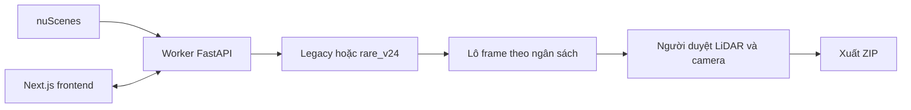

# VCuboidFIT

**Tuyển chọn keyframe LiDAR đáng gán nhãn cho bài toán phát hiện người đi bộ, xe đạp và xe máy (VRU) phục vụ phanh khẩn cấp AEB trên nuScenes.** Hệ thống chọn lô theo ngân sách, thường là 5%, rồi cho người gán nhãn kiểm tra lý do chọn, point cloud, hộp 3D và camera trước khi xuất kết quả.

Phiên bản cấu hình **0.9.0** · cập nhật **15/10/2026** · [báo cáo tiến độ và bằng chứng](docs/project-status.md).

## Hiện đã làm được gì?

| Thành phần | Khả năng hiện có |
|---|---|
| Backend Python + FastAPI | Nhận dữ liệu nuScenes, quản lý job, chọn frame theo ngân sách, phục vụ media và xuất ZIP |
| `c4_legacy` | Engine mặc định: đặc trưng hình học LiDAR trên CPU; có Tầng 1 PointPillars tùy chọn |
| `rare_v24` | Tìm ứng viên VRU, theo dõi và chấm độ hiếm RHCIO; chọn lô có xét đa dạng, giữ thông tin để người duyệt |
| Hai profile | `lidar_only`: LiDAR; `multisensor`: bổ sung camera bằng OpenCV/OpenCLIP, không dùng VLM |
| Website Next.js | Trang giới thiệu, Dashboard, Deep Review, viewer LiDAR/box 3D + 6 camera, trang phương pháp và số đo `/vi-sao` |
| Vận hành | CLI, Docker GPU, notebook Colab, đóng gói nuScenes thành ZIP nhỏ và quản lý/xoá lịch sử |

Tầng 0 và bước chọn của legacy chạy CPU; PointPillars và trích xuất OpenCLIP cần môi trường GPU/dependency tương ứng. Camera được dùng khi chọn profile đa cảm biến. Nhãn đánh giá không dùng để chọn lô từ pool; nhãn seed huấn luyện detector và nhãn đánh giá có vai trò riêng.

## Kết quả đã đo và giới hạn

Benchmark T theo đăng ký trước `pitch-v2` đã chạy trên Colab A100: **1.389 frame, 35 scene, ngân sách 70 frame và 42 instance đích**. M2 (`rare_v24 lidar_only`) so với M1 (legacy): **ΔIY = −0,014; CI95 [−0,164; 0,084]**, kết luận **`not shown / underpowered`**.

**Chưa có bằng chứng `rare_v24` tốt hơn baseline trong phép thử này.** Tầng gom cụm của cấu hình thử nghiệm có reach 14/42 instance đích trong bán kính 1 m. PointPillars đã chạy local và được tích hợp vào luồng mới sau phép thử T, nhưng chưa có benchmark mới xác nhận lợi ích. Không gán kết quả chạy local hiện tại vào số T đã đóng băng.

Nguồn: [JSON benchmark](web/public/demo/bench_pitch.json), [biểu đồ](web/public/demo/fig_iy_budget.png), [báo cáo chi tiết](docs/project-status.md#3-kết-quả-thực-nghiệm). Số đo hiện trên `/vi-sao#bang-chung`; `/vi-sao#phuong-phap` giải thích phép so sánh. Review trên trang chủ là tiêu chí trải nghiệm, chưa phải lời chứng thực khách hàng.

## Chạy backend và frontend sau clone

Yêu cầu: **Python 3.11+**, **Node.js 20+**, **Git + Git LFS**. Docker/GPU tùy chọn cho Tầng 1; 7-Zip chỉ cần với `.7z`/`.rar`. Các lệnh dùng Windows PowerShell; [hướng dẫn đầy đủ và Linux/macOS](docs/getting-started.md).

```powershell
git lfs install
git clone https://github.com/Nguyendev037/VCuboidFit.git
cd VCuboidFit
python -m venv model\worker\.venv
model\worker\.venv\Scripts\python -m pip install -e "model\worker[dev,service]"
cd web
Copy-Item .env.example .env.local
npm ci
cd ..
```

Terminal A, từ root repo — backend, tự đặt workspace/cổng:

```powershell
powershell -NoProfile -ExecutionPolicy Bypass -File model/scripts/dev_up.ps1
# Health: http://127.0.0.1:8001/health ; API: http://127.0.0.1:8001/docs
```

Terminal B, từ root repo — frontend:

```powershell
cd web
npm run dev
# Nếu shim npm/npx lỗi: node node_modules/next/dist/bin/next dev
# Website: http://localhost:3000
```

`web/.env.local`: `WORKER_URL=http://127.0.0.1:8001`, `WORKSPACE=../model/workspace`. Backend/web cùng trỏ `model/workspace/`; backend không tự đọc `.env`. Muốn đổi cổng, xem [run-local](docs/run-local.md).

## Sau clone cần chuẩn bị gì?

| Có trong Git | Cần chuẩn bị trên máy |
|---|---|
| Code, tài liệu, ảnh hero, JSON benchmark và 3 figure | Dataset nuScenes và ZIP upload — [dataset](dataset/README.md) |
| Manifest tham khảo và CLI `vcf-pack` | Manifest/ZIP mới do bạn đóng gói; không dùng checksum của bộ ZIP khác |
| 1 checkpoint PointPillars mini 80 epoch qua Git LFS (~70 MB) | Seed local có `index.parquet`, `t1/cfg/pp_seed.yaml`, `t1/ckpt/seed_latest.pth`; clone không tự có bố cục này |
| Fixture và media mô phỏng trang chủ tại `web/public/demo/showcase/` (~3,3 MB) | Media của các màn mock khác tại `web/public/mock-media/` bị gitignore; dựng khi cần theo [web.md](docs/web.md#media-mẫu-sau-clone) |
| Notebook/cấu hình | Trọng số OpenCLIP/YOLO/DINOv2 khi luồng sử dụng cần — [getting-started](docs/getting-started.md) |

`model/workspace/` không nằm trong Git. `full_mini`, `m2_mini`, `night_v24` là tên job trên máy phát triển, không đi kèm clone. Ba job này đã được người dùng xoá khỏi lịch sử ngày 14/10; dataset và trọng số vẫn giữ trên máy đó. Muốn mở Deep Review, tạo/chạy job mới trước.

Không có dữ liệu vẫn xem phần giới thiệu, mô phỏng trang chủ, phương pháp và benchmark. Media trang chủ được đóng gói sẵn, không cần backend hay lệnh dựng mock. `NEXT_PUBLIC_MOCK=1` giúp khám phá các màn UI khác, không thay kết quả model thật; các màn đó có thể cần media mock local. Script không tìm thấy nuScenes sẽ sinh ảnh xám/cloud tổng hợp, chỉ dùng kiểm giao diện.

## Luồng hoạt động



Dữ liệu lưu theo file, không cần DB. [Model workflow](docs/model-workflow.md) phân biệt engine, profile, Tầng 1, ranh giới nhãn và đánh giá.

## Tài liệu

| Cần tìm | Tài liệu |
|---|---|
| Tiến độ, số đo, giới hạn, bước tiếp | [project-status](docs/project-status.md) |
| Bắt đầu sau clone | [getting-started](docs/getting-started.md) |
| Backend, web và GPU local | [run-local](docs/run-local.md) |
| Pipeline và CLI | [model-workflow](docs/model-workflow.md) |
| UI, media, benchmark, bàn giao agent | [web](docs/web.md) |
| IY/NY/capture/CI và thuật ngữ | [glossary](docs/glossary.md) |
| Colab và giới hạn từng notebook | [colab-dev-setup](docs/colab-dev-setup.md) |
| GPU thuê | [gpu-rental](docs/gpu-rental.md) |
| Module | [web](web/README.md), [model](model/README.md), [dataset](dataset/README.md) |

Snapshot kiểm thử đã đo: web **235 pass**, test backend xoá lịch sử **15 pass**; snapshot full pytest trước đó **488 pass / 3 fail / 3 skip**, nên chưa thể nói toàn repo đều xanh. Kiểm thử kỹ thuật không thay bằng chứng model hiệu quả hơn baseline. Nghiệm thu/demo tổng thể còn cổng chưa đóng; xem báo cáo tiến độ để đọc đúng phạm vi và thời điểm của từng số.

## Dữ liệu và sử dụng

nuScenes thuộc Motional, **CC BY-NC-SA 4.0**; giữ ghi nguồn và điều kiện phi thương mại/chia sẻ tương tự. Repo không phân phối bộ nuScenes đầy đủ hoặc ZIP dataset; ảnh minh hoạ và figure trong Git phục vụ giới thiệu nghiên cứu. Chỉ sửa sản phẩm tại repo này, không sinh lại từ worktree hoặc script đóng gói cũ.
