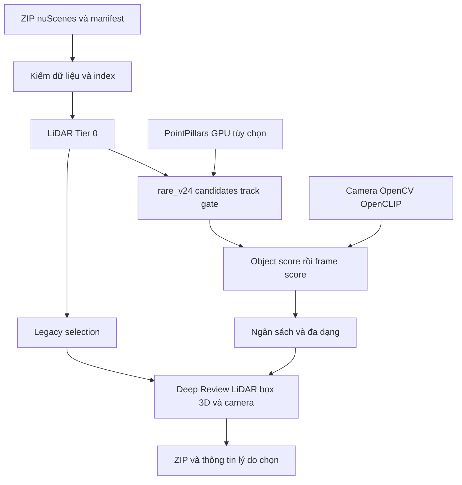

# Luồng model và dữ liệu VCuboidFIT

VCuboidFIT chọn lô keyframe theo ngân sách để người gán nhãn xem xét; mục tiêu nghiên cứu là thu được tình huống VRU hiếm. Việc pipeline chạy được và việc có lợi ích so với baseline là hai cổng khác nhau. Kết quả T hiện tại **chưa chứng minh lợi ích**, xem [project-status](project-status.md).

## 1. Hai engine và hai profile

| Engine/profile | Đầu vào và cách làm | Môi trường |
|---|---|---|
| `c4_legacy` | Descriptor hình học → PCA/rarity → MMR/quota; tín hiệu PointPillars khi có Tầng 1 | CPU cho Tầng 0/chọn; GPU cho Tầng 1 |
| `rare_v24 lidar_only` | LiDAR → candidates/track/gate → độ hiếm RHCIO → object/frame score → chọn lô | Bộ cụm CPU; PointPillars cần tín hiệu đã chuẩn bị |
| `rare_v24 multisensor` | Luồng rare_v24 + chất lượng/bối cảnh camera OpenCV/OpenCLIP + crops ngữ nghĩa | GPU/dependency cho OpenCLIP khi trích xuất |

Service mặc định `c4_legacy` khi request không có `engineVersion` và không đặt `VCF_ENGINE_DEFAULT`. Chọn engine trên Dashboard hoặc đặt biến backend; profile `rare_v24` mặc định `lidar_only`. Hai engine không dùng chung một định nghĩa hiếm: legacy đánh giá rare cell, rare_v24 dùng RHCIO/instance/capture.

## 2. Luồng từ upload tới xuất



Dữ liệu lưu dưới `model/workspace/{uploads,datasets,jobs}`. Worker chạy queue; Next.js proxy API và media. Job đã xoá khỏi lịch sử không còn kết quả Review, nhưng dataset/seed/trọng số vẫn được giữ để chạy mới.

## 3. Candidates và PointPillars

Candidates được xử lý trong hệ toạ độ ego. Box PointPillars từ OpenPCDet ở hệ cảm biến `LIDAR_TOP`, phải chuyển sang ego trước merge/chiếu camera. Đợt sửa 14/10 đã xử lý lệch đáy box và vùng phản xạ thân xe.

`model/worker/configs/candidates_v1.yaml` chứa `ego_exclusion` và `pp_min_score: 0.3`; SHA cấu hình sinh ứng viên được ghi vào `config_used.json`. `rare_def_v24.yaml` vẫn giữ bản freeze dùng cho benchmark T. Không suy rằng SHA định nghĩa hiếm giữ nguyên thì hành vi mọi cấu hình khác cũng giữ nguyên.

PointPillars đã chạy thật trên mini local. T cũ chạy cấu hình ứng viên cụm, nên không lấy số T đó làm bằng chứng cho cải thiện detector mới. Seed local phải có cả index/cfg/checkpoint đúng bố cục; checkpoint LFS duy nhất sau clone chưa đủ để `dev_up.ps1` tự nhận seed local.

## 4. Bối cảnh camera và người duyệt

OpenCV trích chất lượng ảnh; OpenCLIP đọc bối cảnh theo các trục chiếu sáng, chói, ống kính/che khuất và thời tiết. Kết quả lưu bảng `quality_cv`/`context_frame`; crops tạo vector ngữ nghĩa cho vật được chiếu lên camera. Không dùng VLM.

Thẻ dự đoán và lý do chọn là gợi ý để người duyệt đối chiếu, không tự trở thành nhãn chuẩn. `multisensor` cần đủ ảnh, trọng số và cache đúng phiên; CLI từ chối cache crops lỗi thời. T ban ngày không đo được chất lượng đêm/mưa.

## 5. Ranh giới nhãn và phép đánh giá

Các module mining/chọn không đọc nhãn đánh giá của pool. GT được chuẩn bị qua module đọc nhãn chuyên trách, dùng cho eval/viewer và đúng split được phép; detector PointPillars dùng nhãn seed để train. Không gọi toàn bộ pipeline có detector là hoàn toàn không giám sát.

Legacy có split S/V/P và luật freeze riêng. Benchmark `pitch-v2` rare_v24 có V/T, prereg và định nghĩa RHCIO riêng; không đồng nhất tên P của legacy với T của benchmark mới. Định nghĩa, cấu hình và phép so sánh phải freeze trước khi đánh giá; không dùng kết quả tập cuối để tune lại.

IY đo instance hiếm trên mỗi frame đã chọn. Capture B chỉ tính thu được instance ở đúng dạng hiếm; capture A là chỉ số phụ. So sánh M0–M3 trên cùng pool/ngân sách; bootstrap theo scene sinh CI95. Kết luận dựa trên CI của chênh lệch chính, không chỉ nhìn số trung bình.

## 6. CLI thực tế

Từ `model/worker/`, dùng venv đã cài theo [getting-started](getting-started.md). `D` là thư mục nuScenes, `J` là thư mục job mới, thay bằng đường dẫn thực:

```powershell
$env:PYTHONIOENCODING="utf-8"
.venv/Scripts/python -m c4.cli.lidar_index --data-root D --job-dir J
.venv/Scripts/python -m c4.cli.lidar_t0 --data-root D --job-dir J
.venv/Scripts/python -m c4.cli.rare run --data-root D --job-dir J --profile lidar_only
```

Mặc định rare run dùng pool T, reference V; mini in-sample minh hoạ có thể dùng `--pool-split all --ref-split all` theo cấu hình đủ dữ liệu, nhưng không coi số đó là test độc lập. Luồng đa cảm biến cần các đầu vào fit/reference phù hợp:

```powershell
.venv/Scripts/python -m c4.cli.extract_clip --data-root D --job-dir J --device cuda
.venv/Scripts/python -m c4.cli.context cv --data-root D --job-dir J
# Cần chuẩn bị split_manifest.csv theo dataset trước khi fit; không tự gộp V/T.
.venv/Scripts/python -m c4.cli.context fit --job-dir J --split V
.venv/Scripts/python -m c4.cli.context run --data-root D --job-dir J
.venv/Scripts/python -m c4.cli.rare crops --data-root D --job-dir J --device cuda
.venv/Scripts/python -m c4.cli.rare run --data-root D --job-dir J --profile multisensor
```

`crops` cần `rare_objects` từ rare run trước và index camera. `extract_clip`/`crops` cần torch/OpenCLIP trong môi trường chạy; xem `.[gpu]` trong hướng dẫn cài. Không tự chạy benchmark T chỉ để thử chuỗi CLI này.

| CLI | Vai trò |
|---|---|
| `c4.cli.lidar_index`, `lidar_t0` | Index và Tầng 0 |
| `c4.cli.lidar_g1`, `lidar_experiment` | Thống kê GT/đánh giá legacy theo split hợp lệ |
| `c4.cli.rare run`, `rare crops` | Engine rare_v24 và crops |
| `c4.cli.context cv`, `fit`, `run` | Bối cảnh camera |
| `c4.cli.bench_pitch` | Benchmark prereg; không mở lại tập T đã chấm |

Kiểm tham số bằng `--help`; không copy flags của CLI khác. Rare CLI exit 0 = hoàn tất; 2 = thiếu đầu vào/contract/crops lỗi thời; 3 = cấu hình sai; 1 = lỗi khác. Caller đọc log và dừng, không tự sửa freeze/prereg để chạy tiếp.

## 7. Kết quả và tái lập

Engine rare lưu `engines/rare_v24/<selectionId>/{rare_objects.parquet,rare_frames.parquet,config_used.json}` cùng kết quả theo lựa chọn; adapter service đưa vào API/frame/review. Legacy lưu CSV/JSON/Parquet theo job và selection. Mọi bảng đi qua `c4.contracts.read_table/write_table` để kiểm schema/manifest.

Để tái lập cần dữ liệu nguồn, code SHA, cấu hình/SHA, seed/trọng số, split và prereg nếu là benchmark. Clone code không tự khôi phục `model/workspace/` của máy tác giả. Xem [web](web.md), [run-local](run-local.md), [Colab](colab-dev-setup.md) và [GPU thuê](gpu-rental.md).
