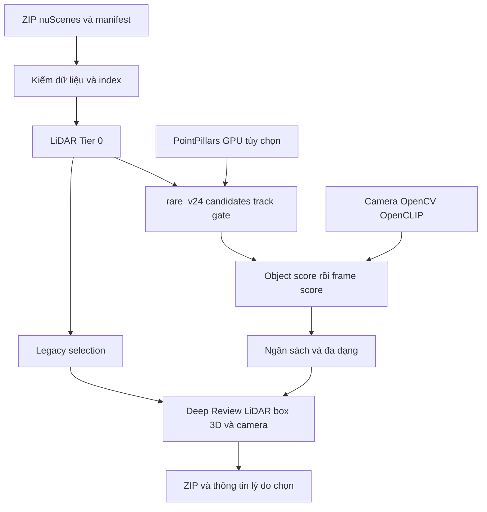

# Luồng model và dữ liệu VCuboidFIT

VCuboidFIT chọn lô keyframe theo ngân sách để người gán nhãn xem xét; mục tiêu nghiên cứu là thu được tình huống VRU hiếm. Việc pipeline chạy được và việc có lợi ích so với baseline là hai cổng khác nhau. Kết quả T hiện tại **chưa chứng minh lợi ích**, xem [project-status](project-status.md).

## 1. Hai engine và hai profile

| Engine/profile | Đầu vào và cách làm | Môi trường |
|---|---|---|
| `c4_legacy` | Descriptor hình học → PCA/rarity → MMR/quota; tín hiệu PointPillars khi có Tầng 1 | CPU cho Tầng 0/chọn; GPU cho Tầng 1 |
| `rare_v24 lidar_only` | LiDAR → candidates/track/gate → độ hiếm RHCIO → object/frame score → chọn lô | Bộ cụm CPU; PointPillars cần tín hiệu đã chuẩn bị |
| `rare_v24 multisensor` | Luồng rare_v24 + chất lượng/bối cảnh camera OpenCV/OpenCLIP + crops ngữ nghĩa | GPU/dependency cho OpenCLIP khi trích xuất |

Service mặc định `c4_legacy` khi request không có `engineVersion` và không đặt `VCF_ENGINE_DEFAULT`. Chọn engine trên Dashboard hoặc đặt biến backend; profile `rare_v24` mặc định `lidar_only`. Hai engine không dùng chung một định nghĩa hiếm: legacy đánh giá rare cell, rare_v24 dùng RHCIO/instance/capture.

## 2. Luồng từ upload tới xuất



Dữ liệu lưu dưới `model/workspace/{uploads,datasets,jobs}`. Worker chạy queue; Next.js proxy API và media. Job đã xoá khỏi lịch sử không còn kết quả Review, nhưng dataset/seed/trọng số vẫn được giữ để chạy mới.

## 3. Candidates và PointPillars

Candidates được xử lý trong hệ toạ độ ego. Box PointPillars từ OpenPCDet ở hệ cảm biến `LIDAR_TOP`, phải chuyển sang ego trước merge/chiếu camera. Đợt sửa 14/10 đã xử lý lệch đáy box và vùng phản xạ thân xe.

`model/worker/configs/candidates_v1.yaml` chứa `ego_exclusion` và `pp_min_score: 0.3`; SHA cấu hình sinh ứng viên được ghi vào `config_used.json`. `rare_def_v24.yaml` vẫn giữ bản freeze dùng cho benchmark T. Không suy rằng SHA định nghĩa hiếm giữ nguyên thì hành vi mọi cấu hình khác cũng giữ nguyên.

PointPillars đã chạy thật trên mini local. T cũ chạy cấu hình ứng viên cụm, nên không lấy số T đó làm bằng chứng cho cải thiện detector mới. Seed local phải có cả index/cfg/checkpoint đúng bố cục; checkpoint LFS duy nhất sau clone chưa đủ để `dev_up.ps1` tự nhận seed local.

## 4. Bối cảnh camera và người duyệt

OpenCV trích chất lượng ảnh; OpenCLIP đọc bối cảnh theo các trục chiếu sáng, chói, ống kính/che khuất và thời tiết. Kết quả lưu bảng `quality_cv`/`context_frame`; crops tạo vector ngữ nghĩa cho vật được chiếu lên camera. Không dùng VLM.

Thẻ dự đoán và lý do chọn là gợi ý để người duyệt đối chiếu, không tự trở thành nhãn chuẩn. `multisensor` cần đủ ảnh, trọng số và cache đúng phiên; CLI từ chối cache crops lỗi thời. T ban ngày không đo được chất lượng đêm/mưa.

## 5. Ranh giới nhãn và phép đánh giá

Các module mining/chọn không đọc nhãn đánh giá của pool. GT được chuẩn bị qua module đọc nhãn chuyên trách, dùng cho eval/viewer và đúng split được phép; detector PointPillars dùng nhãn seed để train. Không gọi toàn bộ pipeline có detector là hoàn toàn không giám sát.

Legacy có split S/V/P và luật freeze riêng. Benchmark `pitch-v2` rare_v24 có V/T, prereg và định nghĩa RHCIO riêng; không đồng nhất tên P của legacy với T của benchmark mới. Định nghĩa, cấu hình và phép so sánh phải freeze trước khi đánh giá; không dùng kết quả tập cuối để tune lại.

IY đo instance hiếm trên mỗi frame đã chọn. Capture B chỉ tính thu được instance ở đúng dạng hiếm; capture A là chỉ số phụ. So sánh M0–M3 trên cùng pool/ngân sách; bootstrap theo scene sinh CI95. Kết luận dựa trên CI của chênh lệch chính, không chỉ nhìn số trung bình.

## 6. CLI thực tế

Từ `model/worker/`, dùng venv đã cài theo [getting-started](getting-started.md). `D` là thư mục nuScenes, `J` là thư mục job mới, thay bằng đường dẫn thực:

```powershell
$env:PYTHONIOENCODING="utf-8"
.venv/Scripts/python -m c4.cli.lidar_index --data-root D --job-dir J
.venv/Scripts/python -m c4.cli.lidar_t0 --data-root D --job-dir J
.venv/Scripts/python -m c4.cli.rare run --data-root D --job-dir J --profile lidar_only
```

Mặc định rare run dùng pool T, reference V; mini in-sample minh hoạ có thể dùng `--pool-split all --ref-split all` theo cấu hình đủ dữ liệu, nhưng không coi số đó là test độc lập. Luồng đa cảm biến cần các đầu vào fit/reference phù hợp:

```powershell
.venv/Scripts/python -m c4.cli.extract_clip --data-root D --job-dir J --device cuda
.venv/Scripts/python -m c4.cli.context cv --data-root D --job-dir J
# Cần chuẩn bị split_manifest.csv theo dataset trước khi fit; không tự gộp V/T.
.venv/Scripts/python -m c4.cli.context fit --job-dir J --split V
.venv/Scripts/python -m c4.cli.context run --data-root D --job-dir J
.venv/Scripts/python -m c4.cli.rare crops --data-root D --job-dir J --device cuda
.venv/Scripts/python -m c4.cli.rare run --data-root D --job-dir J --profile multisensor
```

`crops` cần `rare_objects` từ rare run trước và index camera. `extract_clip`/`crops` cần torch/OpenCLIP trong môi trường chạy; xem `.[gpu]` trong hướng dẫn cài. Không tự chạy benchmark T chỉ để thử chuỗi CLI này.

| CLI | Vai trò |
|---|---|
| `c4.cli.lidar_index`, `lidar_t0` | Index và Tầng 0 |
| `c4.cli.lidar_g1`, `lidar_experiment` | Thống kê GT/đánh giá legacy theo split hợp lệ |
| `c4.cli.rare run`, `rare crops` | Engine rare_v24 và crops |
| `c4.cli.context cv`, `fit`, `run` | Bối cảnh camera |
| `c4.cli.bench_pitch` | Benchmark prereg; không mở lại tập T đã chấm |

Kiểm tham số bằng `--help`; không copy flags của CLI khác. Rare CLI exit 0 = hoàn tất; 2 = thiếu đầu vào/contract/crops lỗi thời; 3 = cấu hình sai; 1 = lỗi khác. Caller đọc log và dừng, không tự sửa freeze/prereg để chạy tiếp.

## 7. CLI đóng gói và lập chỉ mục gói lớn (`trainval_full.py`)

Kịch bản `model/scripts/trainval_full.py` phục vụ đóng gói và kiểm tra toàn vẹn tập dữ liệu train/eval lớn (chuẩn bị huấn luyện A100 qua notebook `TrainModel.ipynb`):
- Tập hợp dữ liệu: 8.182 frames TRAIN (thuộc 205 scenes chính thức của nuScenes có sẵn trên máy dev, không phải toàn bộ 700 scenes) và 602 frames VAL giữ lại (từ 15 scenes official VAL).
- Sweeps: 10 sweeps LiDAR (`MAX_SWEEPS=10`), yêu cầu đóng kín toàn bộ chuỗi predecessor sweeps thực tế.
- Dung lượng: ~61,896 GB dữ liệu và metadata (59,288 GB LiDAR nhị phân và các bảng metadata).
- Ranh giới kiểm định: Các tập benchmark cũ V và P không được dùng làm holdout tập này; tập T cũ của benchmark `pitch-v2` hoàn toàn bị loại trừ (`excluded_T_scenes`), cấm chạm. Việc chạy gói lớn này chỉ phục vụ chuẩn bị dữ liệu, **không tự động coi là chất lượng model đã được cải thiện**.

### Các lệnh CLI chính xác:
```powershell
# Đóng gói dữ liệu thành các phần ZIP độc lập (mặc định <= 2GB/phần)
python model/scripts/trainval_full.py pack --data-root <D> --pool-index <I> --out <O> [--part-bytes 2000000000] [--dry-run]

# Lập chỉ mục Parquet (EXP/index.parquet với cột S/T, source official_train/heldout_val)
python model/scripts/trainval_full.py index --data-root <D> --manifest <M> --exp <E>

# Xác minh tính toàn vẹn và độ bao phủ của gói dữ liệu đã giải nén
python model/scripts/trainval_full.py verify --data-root <D> --manifest <M>
```

### Bảng mã thoát (Exit codes contract):
- `0`: Thành công hợp lệ (valid).
- `2`: Tham số hoặc tệp đầu vào bị thiếu/không hợp lệ (missing/invalid argument or file).
- `3`: Vi phạm ranh giới phân vùng, rò rỉ dữ liệu (VAL vào train, T cũ vào eval), sai lệch checksum, hoặc thiếu dependency sweeps (split/leakage/checksum/coverage gate).
- `1`: Lỗi bất thường ngoài dự kiến (unexpected fault).

Caller bắt buộc phải dừng ngay lập tức khi gặp mã thoát khác 0 và giữ nguyên logs; không có cờ `--force` để bỏ qua kiểm tra toàn vẹn.

## 8. Kết quả và tái lập

Engine rare lưu `engines/rare_v24/<selectionId>/{rare_objects.parquet,rare_frames.parquet,config_used.json}` cùng kết quả theo lựa chọn; adapter service đưa vào API/frame/review. Legacy lưu CSV/JSON/Parquet theo job và selection. Mọi bảng đi qua `c4.contracts.read_table/write_table` để kiểm schema/manifest.

Để tái lập cần dữ liệu nguồn, code SHA, cấu hình/SHA, seed/trọng số, split và prereg nếu là benchmark. Clone code không tự khôi phục `model/workspace/` của máy tác giả. Xem [web](web.md), [run-local](run-local.md), [Colab](colab-dev-setup.md) và [GPU thuê](gpu-rental.md).


## 9. Trọng số PointPillars trainval epoch 6 (TrainModel 2026-10-15)

Thư mục [`model/weights/pointpillars-trainval-e6/`](../model/weights/pointpillars-trainval-e6/) (checkpoint qua Git LFS; `SHA256SUMS.txt` phủ mọi file):

| File | Nội dung |
|---|---|
| `seed_latest.pth` | Checkpoint OpenPCDet epoch 6 (73,2 MB), SHA256 `b581e13a67bd8aff7d9dc88d36fdfb08963300798cb41b39bf3e8a9a6f4a63b0` |
| `pp_seed.yaml` | Config đầy đủ (`cbgs_pp_multihead`, 10 sweeps, không `gt_sampling`); `DATA_PATH` trỏ tới `/content/...` của Colab — đổi khi dùng máy khác |
| `train_config.yaml` | version `v1.0-trainval`, 8.182 frame, CBGS bật, OpenPCDet `233f8498`, determinism seed 0 |
| `run_identity.json` / `parameters.json` | Danh tính lượt chạy: manifest gói `193a5465…`, `source_hash` `25a8e724…`, index `b12804dc…`, `epochs_trained=6` |
| `seed_tokens.txt` / `index.parquet` | 8.182 token train, chỉ mục S/T (T = 602 frame VAL giữ ngoài) |
| `train.log` | Log huấn luyện đầy đủ |

Đã train thế nào:
1. **Dữ liệu:** 205 scene complete official TRAIN (8.182 keyframe, 10 sweeps, ~62 GB LiDAR) đóng gói bằng `trainval_full.py pack` thành 32 part ZIP ≤ 2 GB, upload `MyDrive/datatest/trainval_pp_v2/`. Holdout: 15 scene official VAL ngoài pool cũ (602 frame); benchmark T lịch sử không dùng.
2. **Máy:** Colab A100-SXM4-80GB + High-RAM, notebook [`TrainModel.ipynb`](../model/notebooks/TrainModel.ipynb), torch 2.11 + cu130, spconv 2.3.8, numpy 1.26.4.
3. **Huấn luyện từ đầu** (khởi tạo ngẫu nhiên): batch 8, 8 workers, lịch one-cycle dự kiến 20 epoch (LR đỉnh 1e-3). Bắt đầu 2026-10-14 19:17Z.
4. **Dừng sớm** ở 01:12Z 2026-10-15 sau 6 epoch (~5,9 giờ train) để kịp hạn 08:00 giờ VN (người dùng chọn giảm epoch). Checkpoint epoch 6 được xuất bản bằng ô 8b.

Loss trung bình theo epoch: 1,38 → 0,987 → 0,861 → 0,767 → 0,705 → **0,659** (epoch 6, LR 8,7e-4).

Giới hạn — đọc trước khi dùng:
- LR one-cycle còn ở gần đỉnh khi dừng ⇒ model **chưa hội tụ**; kém hơn bản chạy đủ 20 epoch.
- Đã chấm trên 602 frame VAL (2026-10-15): **mAP 0,209 · NDS 0,282**. Xe con/xe tải/xe máy tốt, người đi bộ/xe đạp/cọc/rào còn yếu (xem §10). `post_train_eval` ghi `init-ckpt (bỏ qua train)` là cách đóng gói checkpoint, không có nghĩa là không train.
- Không thay seed mặc định của Colab/`dev_up.ps1` (vẫn là mini-e80); muốn dùng cho Tầng 1 phải dựng bố cục `index.parquet` + `t1/cfg/pp_seed.yaml` + `t1/ckpt/seed_latest.pth` cho dataset của mình.
- Muốn train tiếp đủ 20 epoch: chạy lại TrainModel với cùng `RUN_ID` khi checkpoint epoch 5–6 còn trên Drive (`run_identity.json` trên Drive đã thêm `epochs_trained`, phải xoá khoá này hoặc đổi `RUN_ID` mới).

## 10. Chấm trọng số trên 602 frame VAL bằng Docker (hướng dẫn từng bước)

Mục đích: đo một bộ trọng số PointPillars nhận diện đúng bao nhiêu trên **602 keyframe VAL giữ lại** (split `T` trong `index.parquet`: 15 scene official VAL, không scene nào dùng để train). Toàn bộ chạy trong Docker, không cần cài Python/OpenPCDet lên máy.

### 10.1. Cần chuẩn bị (một lần)

| Thứ cần có | Kiểm thế nào |
|---|---|
| Docker Desktop đang chạy, có GPU NVIDIA | `docker info` không báo lỗi; `nvidia-smi` thấy GPU |
| Image `vcuboidfit_pointpillars:0.1` (~18,9 GB) | `docker images` có dòng này; chưa có thì build: `docker compose -f model/docker/tier1/docker-compose.yml build` (~15 phút) |
| Dữ liệu nuScenes **v1.0-trainval** gồm `v1.0-trainval/` (bảng JSON), `samples/LIDAR_TOP`, `sweeps/LIDAR_TOP` của 15 scene VAL | ví dụ `E:\nuscenes_trainval`; thiếu `maps/` không sao (script tự dựng mask giả) |
| Trọng số: thư mục có `seed_latest.pth` + `pp_seed.yaml` (dạng `model/weights/...`) hoặc `t1/ckpt/seed_latest.pth` + `t1/cfg/pp_seed.yaml` (dạng thí nghiệm) | `git lfs pull` nếu `seed_latest.pth` chỉ vài trăm byte |

GPU 8 GB là đủ: lượt chấm dùng ~1,1 GB VRAM.

### 10.2. Chạy một lệnh (PowerShell, tại gốc repo)

```powershell
# Trọng số trainval epoch 6 (mặc định)
.\model\scripts\eval_val.ps1 -Nusc E:\nuscenes_trainval

# Bộ trọng số khác, ví dụ seed mini-e80, chấm trên CÙNG 602 frame để so sánh
.\model\scripts\eval_val.ps1 -Nusc E:\nuscenes_trainval -Weights .\model\workspace\experiments\mini-e80
```

Tham số: `-Weights` (thư mục trọng số), `-Index` (index khác; mặc định index của e6, split `T`), `-Out` (thư mục kết quả; mặc định `model/workspace/experiments/eval-val602/<tên thư mục trọng số>`), `-Batch` (mặc định 2).

Thời gian đo trên RTX 4060 Laptop: dựng info ~45 giây (chỉ lần đầu cho mỗi thư mục `-Out`), suy luận ~170 giây (~285 ms/frame, gồm cả đọc 10 sweeps từ ổ đĩa), chấm devkit ~1 phút. Tổng khoảng **4–5 phút**.

Lệnh tương đương không qua script (bash hoặc Linux):

```bash
docker run --rm --gpus all --shm-size 8g \
  -v /path/nuscenes_trainval:/nusc:ro -v $PWD/model/weights/pointpillars-trainval-e6:/w:ro \
  -v $PWD/model/workspace/experiments/eval-val602/e6:/out -v $PWD/model/worker:/work/worker \
  -w /work/worker -e PYTHONPATH=/work/worker:/opt/OpenPCDet vcuboidfit_pointpillars:0.1 \
  python -m c4.lidar.tier1.eval_ckpt --ckpt /w/seed_latest.pth --cfg /w/pp_seed.yaml \
  --index /w/index.parquet --nusc /nusc --out /out
```

(Git Bash trên Windows: thêm `MSYS_NO_PATHCONV=1` trước `docker`.)

### 10.3. Kết quả nằm ở đâu, đọc thế nào

| File trong `-Out` | Nội dung |
|---|---|
| `eval.txt` | Bảng của nuscenes-devkit: từng lớp có AP ở 4 ngưỡng khoảng cách 0,5/1/2/4 m và 5 loại sai số; cuối bảng là **mAP** và **NDS** |
| `eval_summary.json` | Số frame, thời gian, GPU, VRAM, toàn bộ metric dạng máy đọc |
| `results_nusc.json`, `metrics_details.json`, `plots/` | Dự đoán gốc và đường PR của devkit |
| `eval.log` | Log đầy đủ, mở khi thoát khác 0 |

- **mAP** (0–1, càng cao càng tốt): trung bình AP của **10 lớp**. **NDS** gộp mAP với 5 sai số vị trí, kích thước, hướng, vận tốc và thuộc tính.
- Lớp **không có đối tượng nào** trong 602 frame vẫn bị tính AP = 0. Ở split T, `bus`, `trailer` và `construction_vehicle` không có GT nên mAP tối đa chỉ đạt 0,7 dù model hoàn hảo.
- Đây là **subset eval**: GT được lọc về đúng 602 frame. Không so trực tiếp với số full-val 6.019 frame của bài báo; dùng để **so các bộ trọng số với nhau trên cùng tập**.

Mã thoát: `0` ok · `2` split rỗng hoặc thiếu info cho một số frame (thiếu file LiDAR) · `3` container không thấy GPU (thiếu `--gpus all` hoặc Docker chưa bật GPU) · `4` thiếu file trọng số/index/image.

### 10.4. Kết quả đo 2026-10-15 (602 frame, RTX 4060)

| Lớp | Số GT* | e6 (trainval 8.182 frame, 6 epoch) | mini-e80 (seed mặc định) |
|---|---:|---:|---:|
| car | 2.446 | **0,785** | 0,159 |
| truck | 145 | **0,607** | 0,008 |
| motorcycle | 258 | **0,540** | 0 |
| pedestrian | 85 | 0,162 | 0 |
| barrier | 101 | 0 | 0 |
| bicycle | 42 | 0 | 0 |
| traffic_cone | 46 | 0 | 0 |
| bus / trailer / construction_vehicle | 0 | (0, không có GT) | (0) |
| **mAP / NDS** | | **0,209 / 0,282** | 0,017 / 0,065 |

\* GT có ≥1 điểm LiDAR, trong tầm chấm của devkit (50/40/30 m theo lớp).

Nhận xét: e6 tốt hơn mini-e80 khoảng 12 lần về mAP. Trên 7 lớp có GT, mAP là 0,299. Xe con, xe tải và xe máy đã ngang mức tham chiếu PointPillars full-train. Lớp nhỏ (người đi bộ, xe đạp, cọc, rào) còn yếu vì 3 lý do: (1) dừng ở epoch 6/20 khi LR one-cycle còn ở gần đỉnh, chưa qua pha giảm LR vốn cho nhiều điểm nhất; (2) tắt `gt_sampling` để tránh rò nhãn ngoài S, mà đây là augmentation chủ lực cho lớp hiếm; (3) chỉ có ~29% lượng frame train của nuScenes. Tập 15 scene khá nhỏ (42 xe đạp, 85 người), nên AP của lớp nhỏ dao động mạnh.

Bằng chứng: `BuildLab/planning/16_2026-10-14_a100-full-train/evidence/EVAL_VAL602/`.
