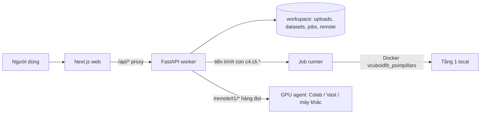

# VCuboidFIT — Tài liệu tham chiếu hệ thống

Bản này mô tả **đúng những gì code đang làm** tại commit `429acc5` (16/10/2026), viết lại sau khi rà toàn bộ `model/worker/c4`, `model/worker/service`, `configs/`, script vận hành và web. Khi tài liệu khác mâu thuẫn với bản này, đối chiếu code; mục [§15](#15-lệch-tài-liệu-và-lỗi-phát-hiện-khi-rà) liệt kê các chỗ đã thấy lệch.

Mục lục: [1 Tổng quan](#1-tổng-quan) · [2 Kiến trúc](#2-kiến-trúc-chạy) · [3 Nhận dữ liệu](#3-nhận-dữ-liệu) · [4 Job runner](#4-job-runner-và-pipeline) · [5 LiDAR Tầng 0/1](#5-pipeline-lidar) · [6 Engine c4_legacy](#6-engine-c4_legacy) · [7 Pipeline camera](#7-pipeline-camera-dinov2--yolo11--openclip) · [8 Tầng bối cảnh camera](#8-tầng-bối-cảnh-camera-c0c3) · [9 Engine rare_v24](#9-engine-rare_v24) · [10 Mô hình và xử lý ảnh](#10-bảng-mô-hình-và-xử-lý-ảnh) · [11 Đánh giá](#11-nhãn-đánh-giá-và-benchmark) · [12 API](#12-api-backend) · [13 Web](#13-web) · [14 Triển khai](#14-triển-khai-và-nơi-chạy) · [15 Lệch/lỗi](#15-lệch-tài-liệu-và-lỗi-phát-hiện-khi-rà) · [16 Bất biến](#16-bất-biến)

## 1. Tổng quan

VCuboidFIT chọn một lô keyframe nuScenes theo ngân sách (mặc định 5%) để người gán nhãn xem trước, ưu tiên tình huống VRU (người đi bộ, xe đạp, xe máy) hiếm cho bài toán AEB. Kết quả là danh sách frame xếp hạng, lý do chọn và gói ZIP xuất; hệ thống **không tự gán nhãn**.

| Khối | Vị trí | Công nghệ |
|---|---|---|
| Engine chọn lô | `model/worker/c4/` | Python 3.11+, numpy/pandas/scikit-learn, OpenCV, PyTorch (tuỳ chọn) |
| Backend | `model/worker/service/` | FastAPI, lưu file (không DB) |
| Tầng 1 LiDAR | `c4/lidar/tier1/`, `model/docker/tier1/` | OpenPCDet `233f849` + PointPillars, CUDA |
| Web | `web/` | Next.js (App Router), React, Three.js viewer |
| Vận hành | `model/scripts/`, `deploy/azure/`, `deploy/vast/` | PowerShell, Docker, Colab, Azure Container Apps |

Có **2 engine** (`c4_legacy`, `rare_v24`), **2 pipeline job** (`lidar`, `camera`) và **2 profile** của rare_v24 (`lidar_only`, `multisensor`). Bảng dưới là các tổ hợp thật sự chạy được:

| Dataset | Pipeline job (tự chọn) | Engine chọn lô | Mô hình dùng |
|---|---|---|---|
| Có `LIDAR_TOP` (mọi nuScenes) | `lidar`: `lidar_index → t0 → t1` | `c4_legacy` (mặc định) | Tầng 0 hình học CPU; Tầng 1 PointPillars nếu có |
| Có `LIDAR_TOP` | `lidar` | `rare_v24 lidar_only` | Cụm DBSCAN CPU + PointPillars nếu có `t1/preds_orig.pkl` |
| Có `LIDAR_TOP` | `lidar` | `rare_v24 multisensor` | Như trên + OpenCV + OpenCLIP. **Cần chạy CLI trước**, xem [§15 F2](#15-lệch-tài-liệu-và-lỗi-phát-hiện-khi-rà) |
| Chỉ ảnh camera | `camera`: `index → dino → det → clip → merge` | `c4_legacy` camera | DINOv2 + YOLO11 + OpenCLIP + OpenCV |

## 2. Kiến trúc chạy

- Web gọi worker qua `WORKER_URL` (mặc định `http://127.0.0.1:8001`, [worker.ts](../web/lib/server/worker.ts)). Upload chia chunk 50 MB đi thẳng vào `WORKSPACE/uploads` do route Next.js ghi.
- Worker cấu hình hoàn toàn bằng biến môi trường ([settings.py](../model/worker/service/settings.py)): `WORKSPACE`, `C4_PROFILE` (`local-4060`/`cloud`/`azure-lite`), `VCF_REMOTE_TOKEN`, `VCF_T1_EXP`, `VCF_SESSIONS`, `VCF_SESSION_TTL_H` (24), `VCF_ENGINE_DEFAULT`, `VCF_DEMO_PASSWORD` (đọc ở web `proxy.ts`), `C4_FAKE_MODELS=1` (mô hình giả cho test).
- Mọi bảng ghi qua `c4.contracts.write_table/read_table`: kiểm schema + file `.manifest.json` kèm SHA. Schema hiện tại `1.2`.

## 3. Nhận dữ liệu

1. Upload: web nhận file (ZIP/7z/RAR, giới hạn tổng `MAX_UPLOAD_GB`, `GET /api/uploads/limits`), ghép chunk, `finalize` → `POST /datasets`.
2. [archives.py](../model/worker/service/archives.py) giải nén (7z cho `.7z/.rar`), gộp các `data/` vào `datasets/<id>/data/`; `vcf_manifest.json` (từ `vcf-pack`) dùng để kiểm checksum.
3. [nusc.py](../model/worker/c4/data/nusc.py) đọc thẳng JSON nuScenes, không dùng devkit. Bắt buộc: `scene, sample, sample_data, calibrated_sensor, ego_pose, sensor`; tuỳ chọn: `category, instance, sample_annotation, visibility, attribute, log`. Đúng **một** thư mục `v1.0-*`.
4. `report.json` ghi `ok`, số scene/frame, ảnh theo camera, `hasLidar`, `hasAnnotations`, cảnh báo.
5. `POST /jobs`: pipeline = `lidar` nếu `hasLidar`, ngược lại `camera` ([jobs.py](../model/worker/service/jobs.py)).

## 4. Job runner và pipeline

[runner.py](../model/worker/c4/jobs/runner.py) chạy từng stage là một tiến trình con `python -m c4.cli.<module> --job-dir J --data-root D --profile P --resume`, log ở `logs/<stage>.log`, tiến độ ở `progress/<stage>.json`, trạng thái ở `status.json`.

| Pipeline | Stage → module | Output bắt buộc |
|---|---|---|
| `lidar` | `lidar_index` → `c4.cli.lidar_index` | `lidar/index.parquet` (+ `index/frames.parquet`, `cam_poses`, thumbs, `media/lidar/*.bin`, GT nếu có nhãn) |
| | `t0` → `lidar_t0` | `lidar/z0.npy`, `lidar/filter.parquet` (+ `desc_raw.npz`, `media/bev/*.png`) |
| | `t1` → `lidar_t1` (tuỳ chọn) | `t1/signals.parquet` |
| `camera` | `index` → `build_index` | `index/frames.parquet`, `index/cam_poses.parquet` |
| | `dino` → `extract_dino` | `cache/dino_cls.npy`, `cache/feat_dino.parquet` |
| | `det` → `extract_det` | `cache/detections.parquet`, `cache/feat_det.parquet` |
| | `clip` → `extract_clip` | `cache/clip_img.npy`, `cache/feat_clip.parquet` |
| | `merge` → `merge_features` | `cache/features_cache.parquet` |

- Một khoá `workspace/gpu.lock` cho cả job: job thứ hai ở trạng thái `queued`.
- Stage xong = đủ output **và** dấu `progress/<stage>.done.json`; chạy lại thì bỏ qua.
- `t1` lỗi hoặc thoát 0 mà không có output ⇒ stage `failed/skipped` kèm lý do tiếng Việt, job vẫn `done`.
- Mã thoát stage: `0` ok · `2` vi phạm contract · `3` hết VRAM ở batch 1 · `4` thiếu file/trọng số · `5` Docker lỗi (t1).

## 5. Pipeline LiDAR

Cấu hình cố định trong [lidar.yaml](../model/worker/configs/lidar.yaml) (schema 1.2, "không tune").

### 5.1 L0 — chỉ mục và chia tập

- Keyframe `LIDAR_TOP`; ego pose (x, y, yaw), timestamp, đường dẫn LiDAR.
- Chia **theo scene** ([splits.py](../model/worker/c4/lidar/splits.py), seed 0): nuScenes-mini ⇒ T = `scene-0103, scene-0916`, S = 2 scene, V = 3 scene, còn lại P. Trainval ⇒ T = scene official VAL, S = 5% scene train, V = 100 scene, còn lại P. Dataset lạ ⇒ mọi scene là `pool`.
- Phần hiển thị (không tham gia chọn): `index/frames.parquet`, `cam_poses`, thumbnail WebP 320×180 mỗi ảnh camera, point cloud sang hệ ego ghi float16 `media/lidar/<token>.bin`, hộp 2D/3D GT nếu có nhãn.

### 5.2 L1 — Tầng 0 (CPU, không mô hình)

Mỗi frame ([descriptor.py](../model/worker/c4/lidar/descriptor.py)):
1. Đọc `.pcd.bin` (float32 × 5), bỏ điểm thân xe |x|,|y| < 1 m, cắt ±50 m, voxel 0,2 m.
2. Lọc: < 2.000 điểm sau khi bỏ thân xe ⇒ `few_points`; đọc lỗi ⇒ `read_error` (`keep = False`).
3. Năm khối: **A** histogram khoảng cách (8 bin 0–70 m) + log số điểm; **B** histogram độ cao −3…5 m bước 0,5 m; **C** lưới BEV 50×50 ô 2 m (log đếm); **D** cụm: RANSAC mặt đất (60 vòng, ngưỡng 0,25 m, bán kính 25 m) → DBSCAN (eps 0,6 m, min 8) → đếm cụm theo kích thước/diện tích BEV, số cụm nhỏ-xa (≤ 20 điểm, > 30 m); **E** tỷ lệ điểm không-mặt-đất trong 3 m + trung bình/độ lệch cường độ.
4. z-score từng khối, chia √d khối, ghép, PCA 64 chiều ⇒ `z0.npy`. Ảnh BEV 256 px ⇒ `media/bev/`.

### 5.3 L2 — Tầng 1 PointPillars (GPU)

- Huấn luyện ([train_seed.py](../model/worker/c4/lidar/tier1/train_seed.py)): OpenPCDet `cbgs_pp_multihead`, từ đầu, chỉ trên seed S, 10 sweeps, không `gt_sampling`.
- Suy luận ([infer_t1.py](../model/worker/c4/lidar/tier1/infer_t1.py)): mỗi keyframe chạy 2 lượt (gốc + lật), lấy `z1` (BEV pooled), box, nhãn, điểm; `preds_orig.pkl`.
- Tín hiệu ([uncertainty.py](../model/worker/c4/lidar/uncertainty.py)), box score ≥ 0,1: **Ent** = trung bình entropy nhị phân của score; **Inc** = 1 − (số cặp khớp gốc/lật cùng lớp, tâm BEV < 1 m) / max(số box); **Nov** = khoảng cách nhỏ nhất từ `z1` tới `z1` của seed (bằng 0 và `nov_source=none` khi không có seed). `Unc = ½ r(Ent) + ½ r(Inc)`.
- Ba cách chạy: Docker local (`VCF_T1_EXP` trỏ thư mục có `index.parquet`, `t1/cfg/pp_seed.yaml`, `t1/ckpt/seed_latest.pth`); agent từ xa kéo việc qua `/remote/t1/*` ([remote.py](../model/worker/service/remote.py), [colab_agent.py](../model/scripts/colab_agent.py)), mặc định dùng seed mini-e80 qua Git LFS (sha256 `47c982c5…`, 10 sweeps); hoặc nút "Chạy Tầng 1" (`POST /jobs/{id}/t1/run`).
- Trọng số có trong Git LFS: mini-e80 (mAP 0,017 trên 602 frame VAL) và [trainval-e6](../model/weights/pointpillars-trainval-e6/) (mAP 0,209 / NDS 0,282), chi tiết ở [model-workflow §9–10](model-workflow.md#9-trọng-số-pointpillars-trainval-epoch-6-trainmodel-2026-10-15).

## 6. Engine c4_legacy

### 6.1 Chọn lô cho job LiDAR ([pipeline.py](../model/worker/c4/lidar/pipeline.py))

1. **Rar** = trung bình khoảng cách `z0` tới k = 10 láng giềng **khác scene** và hợp lệ.
2. Hạng phần trăm `r_rar, r_nov, r_unc` trên frame `keep`; thiếu Tầng 1 ⇒ `r_nov = r_unc = 0`.
3. `S = α·r_rar + β·r_nov + γ·r_unc`. Mặc định Tầng 0: (1, 0, 0). Preset Tầng 1: balanced (0,5; 0,25; 0,25), rare_first (0,8; 0,1; 0,1), hard_for_model (0,2; 0,3; 0,5), safety_scenarios (0,6; 0; 0,4). `nov_source=none` ⇒ β = 0, chuẩn hoá lại α, γ.
4. **MMR** ([mmr.py](../model/worker/c4/mining/mmr.py)): `util = λ·S − (1−λ)·max_sim`, λ theo đa dạng low/medium/high = 0,9/0,7/0,5; trần m frame/scene (mặc định 4); bỏ frame cách < `min_gap` trong cùng scene. Điểm vào MMR chuẩn `minmax`.
5. `B = ceil(budget × N)`. Chạy kèm baseline: `t0_rar_topk`, `coreset_z0`, `hybrid_nodiv`, `t1_nov_mmr`, `t1_unc_mmr`, random và random theo quota (10 seed).
6. Có nhãn ⇒ chấm recall/uplift/precision/coverage theo "rare cell" ([lidar/eval.py](../model/worker/c4/lidar/eval.py)); thẻ "Hiếm/Lạ với model/Khó" khi hạng ≥ 0,8; nhóm trùng theo cosine `z0` ≥ 0,95.

### 6.2 Chọn lô cho job camera

Xem [§7.6](#76-chấm-điểm-và-chọn).

## 7. Pipeline camera (DINOv2 + YOLO11 + OpenCLIP)

Chỉ chạy khi dataset **không có LiDAR** (hoặc gọi CLI tay). Cấu hình mô hình theo profile ([profiles/](../model/worker/configs/profiles/)); trọng số tải một lần bằng [fetch_weights.py](../model/scripts/fetch_weights.py) vào `workspace/weights` (job chạy offline, `HF_HUB_OFFLINE=1`).

### 7.1 S0 — chỉ mục ảnh

Một dòng mỗi ảnh camera keyframe có file thật, 6 camera theo thứ tự `CAM_FRONT, CAM_FRONT_LEFT, CAM_FRONT_RIGHT, CAM_BACK, CAM_BACK_LEFT, CAM_BACK_RIGHT`; `cam_poses` (camera→ego, quaternion, intrinsic). GT (`gt_rare`, hộp 2D/3D) chỉ khi có annotation.

### 7.2 S1 — DINOv2 + chất lượng ảnh

- Ảnh: PIL RGB → resize **448×252** bilinear → [0,1] → chuẩn hoá ImageNet → `dinov2_vitb14` (torch.hub local), autocast fp16 trên CUDA → CLS L2 ⇒ `dino_cls.npy` (N × 768 float16).
- **Novelty** `nov_knn` = trung bình (1 − cosine) tới 10 láng giềng khác scene (pool một scene: cùng scene nhưng cách ≥ 4 frame).
- Chất lượng (OpenCV, cùng batch): ảnh xám luma (0,299/0,587/0,114) 448×252 ⇒ `q_bright` = trung bình, `q_blur` = phương sai Laplacian.
- Chạy theo shard 2.048 ảnh, ghi nguyên tử, resume theo chữ ký (model, kích thước, danh sách ảnh); OOM ⇒ chia đôi batch, batch 1 vẫn OOM ⇒ exit 3. Ảnh hỏng ⇒ tensor 0, không làm sập stage.

### 7.3 S2 — YOLO11m

- Ultralytics `yolo11m.pt` (dự phòng `yolo11s.pt`), đọc ảnh gốc 1600×900, `imgsz` 960, `conf ≥ 0,05`, `half` trên GPU, chunk 256 ảnh. Kết quả ghép lại theo đường dẫn (ảnh hỏng = 0 detection).
- Bất định mỗi ảnh ([uncertainty.py](../model/worker/c4/mining/uncertainty.py)): `det_ent` = trung bình entropy nhị phân của conf; `det_tmp` = |Δ số box conf ≥ 0,5 so với frame trước cùng camera| / max(…, 1); **Unc = ½·Ent + ½·Tmp**.

### 7.4 S3 — OpenCLIP

- `ViT-B-16` / `openai`, `force_quick_gelu=True` (thiếu cờ này embedding lệch). Ảnh resize thẳng **224×224** (không cắt giữa để giữ rìa khung), chuẩn hoá CLIP, fp16 ⇒ `clip_img.npy` (N × 512 float16, L2).
- 6 query mặc định ([queries.yaml](../model/worker/configs/queries.yaml)): night_rain, motorcycle_intersection, crowded_crosswalk, construction_vehicle, bicycle, occluded_far ⇒ `qry_max`, `qry_best` = cosine cao nhất. Query tuỳ chỉnh từ web được mã hoá bằng text encoder chạy CPU, cache LRU 32 bộ.
- `clip_img.npy` còn được **tầng bối cảnh** ([§8](#8-tầng-bối-cảnh-camera-c0c3)) dùng lại.

### 7.5 S4 — gộp

Ghép theo (`sample_token`, `cam`); `q_ok = q_bright ≥ 8 ∧ q_blur ≥ 15 ∧ det_n ≥ 1` ([base.yaml](../model/worker/configs/base.yaml)).

### 7.6 Chấm điểm và chọn

- Hạng phần trăm trên ảnh đủ điều kiện ⇒ `s = α·r_nov + β·r_unc + γ·r_qry`; preset (α, β, γ): balanced (0,4; 0,3; 0,3), rare_first (0,6; 0,2; 0,2), hard_for_model (0,2; 0,6; 0,2), safety_scenarios (0,2; 0,2; 0,6).
- Frame = ảnh có `s` cao nhất (best_cam); embedding frame = trung bình DINO các camera rồi L2.
- MMR như §6.1 (m = 3, min_gap = 4, tự nới m rồi min_gap khi không đủ B, có cảnh báo). Kèm ablation novelty/uncertainty/query, `hybrid_nodiv`, random 5 seed; nhóm trùng cosine ≥ 0,95.

## 8. Tầng bối cảnh camera (C0–C3)

Phục vụ profile `multisensor` và trang `/review/context`. Không VLM, không huấn luyện. Chạy bằng CLI [context.py](../model/worker/c4/cli/context.py): `cv` → `fit --split V` → `run`. Tài liệu chi tiết kèm ví dụ tính tay: [camera-layer](camera-layer/README.md).

| Bước | Làm gì | Đầu ra |
|---|---|---|
| C0 | Độ cao mặt trời từ timestamp (UTC) + vĩ/kinh độ `log.location` ([locations.yaml](../model/worker/configs/locations.yaml)), NOAA rút gọn, sai số < 0,3° | `sun_elev_deg` |
| C1 | 13 đặc trưng OpenCV mỗi ảnh | `cache/quality_cv.parquet` |
| C2 | OpenCLIP zero-shot 4 trục từ `clip_img.npy` | xác suất mỗi trục |
| C3 | Luật ghép + ngưỡng fit trên V | `cache/context_frame.parquet` |

**C1 — xử lý ảnh** ([quality_cv.py](../model/worker/c4/context/quality_cv.py)): `cv2.imdecode(IMREAD_REDUCED_COLOR_2)` (đọc 1/2 độ phân giải, chịu đường dẫn Unicode) → `INTER_AREA` về 448×252. Đặc trưng: `luma_mean`, `v_mean`, `v_p5`, `v_p95` (V = max(B,G,R)), `sat_frac` (V ≥ 250), `blob_max_frac` và `blob_count` (vùng bão hoà sau dilate 3×3, ≥ 20 px), `tile_range` (chênh sáng lưới 4×4), `veil = v_p5/v_p95`, `noise_sigma` (Immerkær), `lap_var_raw`, `lap_var_dn` (Laplacian sau Gaussian 5×5 σ1), `sharp_ratio = lap_var_dn/σ²`. Ảnh hỏng ⇒ `img_ok=False`, mọi cột 0.

**C2** ([context_axes_v1.yaml](../model/worker/configs/context_axes_v1.yaml), đóng băng): illum {day, lowlight, night}, glare {none, headlight, sun}, lens {clean, droplets, blurred}, weather {dry, rain, fog}; mỗi lớp 3 prompt, lấy trung bình rồi L2; softmax **riêng từng trục** với `logit_scale` của model (≈ 100).

**C3 — cờ CV** (ngưỡng = phân vị trên V, [thresholds.py](../model/worker/c4/context/thresholds.py)): `NIGHT_CV` v_mean < P95 của ảnh đêm; `GLARE_CV` (sat_frac ≥ P97,5 ∧ blob ≥ P97,5) ∨ (tile_range ≥ P97,5 ∧ sat_frac ≥ P97,5); `BLUR_CV` sharp_ratio < P2,5; `VEIL_CV` veil ≥ P97,5. Biên CLIP `m_axis` = P20 của (top1 − top2) trên V; hạ xuống P10 nếu > 15% ảnh V vào hàng đợi duyệt. Ngưỡng mặt trời cố định: đêm < −6°, chạng vạng < 6°.

**C3 — luật** ([fuse.py](../model/worker/c4/context/fuse.py), `ctx_v1.1`): illum ưu tiên mặt trời, CLIP ngược hẳn (ngày/đêm) với biên ≥ m ⇒ `DISAGREE`; glare cần cờ CV hoặc biên ≥ `min(2m, (1+m)/2)`, sinh nhãn `glare_headlight`/`glare_sun`; lens chỉ gán khi có `BLUR_CV`/`VEIL_CV`; weather không gán ban đêm (CLIP cho mưa ≈ 0,8 mọi cảnh đêm). Chỉ `DISAGREE` vào hàng đợi duyệt; ảnh hỏng luôn vào hàng đợi. Chưa có file ngưỡng ⇒ mọi tag null, cảnh báo `CONTEXT_NOT_FROZEN`.

## 9. Engine rare_v24

Hàm [run_rare_v24](../model/worker/c4/rare/pipeline.py). Phía chọn **không đọc nhãn**; chỉ `c4.rare.gt_rhcio` đọc annotation và chỉ `c4.rare.eval` đọc GT.

### 9.1 Ứng viên vật thể ([candidates.py](../model/worker/c4/rare/candidates.py))

1. **Cụm Tầng 0**: tiền xử lý như §5.2 → bỏ mặt đất RANSAC → DBSCAN (eps 0,6, min 8, tối đa 100k điểm) → điểm đưa sang **hệ ego** bằng hiệu chuẩn LIDAR_TOP ([calib.py](../model/worker/c4/rare/calib.py), cache `cache/lidar_calib.parquet`) → yaw PCA + hộp bám sát. Lớp dự đoán theo kích thước ([class_map_pred_v24.yaml](../model/worker/configs/class_map_pred_v24.yaml)): pedestrian, bicycle, motorcycle, vru_unknown, còn lại other.
2. **PointPillars** (khi có `t1/preds_orig.pkl`): bỏ score < 0,3, đổi sang ego, 10 lớp → pedestrian/bicycle/motorcycle hoặc other.
3. Bỏ ứng viên nằm trên thân xe (hộp ego x ∈ [−1,5; 3,5], y ∈ [−1,2; 1,2], [candidates_v1.yaml](../model/worker/configs/candidates_v1.yaml)).
4. Ghép tham lam theo BEV-IoU ≥ 0,3 (`merged`); cụm không khớp khi có Tầng 1 ⇒ `missed_by_model`.
5. **Theo dõi**: Hungarian trên khoảng cách BEV toàn cục giữa hai frame liền kề cùng scene, ghép khi ≤ 1,5 m + 3 m/s·dt ⇒ `track_id`, `speed_mps`.

Thiếu hiệu chuẩn ⇒ giữ hệ cảm biến, cảnh báo `LIDAR_CALIB_MISSING`. `modelMode` = `cluster+pp_frozen` hoặc `cluster_only`.

### 9.2 Cổng frame ([gate.py](../model/worker/c4/rare/gate.py))

`outlier` (bị lọc LiDAR) · `suspect` (không ứng viên; ‖z0 − mean‖ > 2·3σ; mọi vật dưới `min_pts`) · `valid`. Chỉ `valid` được chọn.

### 9.3 Tham chiếu và điểm vật ([object_score.py](../model/worker/c4/rare/object_score.py))

- Tham chiếu fit **bằng dự đoán** trên frame `ref_split`, chỉ nhóm VRU: tần suất lớp, tứ phân vị khoảng cách/số điểm theo lớp ⇒ cell, tần suất frame chứa cell, trung vị/độ lệch kích thước. Ngưỡng R1/R2 = phân vị (1 − α = 0,9) của surprisal `u = −ln p`. Cần ≥ 50 vật VRU, thiếu ⇒ `PRED_REF_TOO_SMALL`.
- `s_obj = 0,15·shape + 0,35·slice + 0,30·vru + 0,20·unc` (cắt [0,1]): shape = 1 − exp(−½z²) lệch kích thước; slice = hạng surprisal cell (cell chưa thấy = 1); vru = 1 (ped/bike/moto), 0,5 (vru_unknown), 0 (other); unc = Unc Tầng 1 của frame.

### 9.4 Ngữ nghĩa camera (chỉ `multisensor`, [semantic.py](../model/worker/c4/rare/semantic.py))

1. Chiếu 8 góc hộp ego lên 6 camera ([project.py](../model/worker/c4/rare/project.py)), bỏ camera có góc sau ống kính, giữ **một** camera có tỷ lệ hộp nằm trong ảnh lớn nhất (≥ 0,3).
2. Crop nới 20% mỗi cạnh, resize 224×224 bilinear, OpenCLIP ViT-B-16 ⇒ `cache/rare_crops.npy` (`c4.cli.rare crops`, cần GPU/torch).
3. `r_sem` = hạng novelty k-NN (k 10, khác scene) của crop; 12 khái niệm zero-shot ([concepts_v1.yaml](../model/worker/configs/concepts_v1.yaml)): nhóm R (wheelchair, stroller, child, scooter_rider, cyclist_passenger, delivery_rider, animal_on_road, person_lying, police_directing, construction_worker) và nhóm I (pedestrian_crossing_front, cyclist_merging); trúng khi cosine > P99,5 trên crop của `ref_split`.
4. `s_obj ← 0,8·s_obj + 0,2·max(r_sem, 1 nếu trúng khái niệm)`. Crops lệch tập ứng viên hiện tại ⇒ `CROPS_STALE`.

### 9.5 Điểm frame và thẻ RHCIO ([frame_score.py](../model/worker/c4/rare/frame_score.py))

`raw = 0,70·max s_obj + 0,15·min(số VRU/5, 1) + 0,15·0,3·[mưa/sương hoặc đêm]`; `s_frame` = hạng trên frame valid. Thẻ dự đoán: **R1** lớp hiếm, **R2** cell hiếm (vượt ngưỡng V), **R3** VRU di chuyển ≥ 0,5 m/s trong mưa/đêm, **H** vật xa > 30 m hoặc < 10 điểm, **C** bối cảnh mưa/sương/đêm, **I** VRU di chuyển trong hành lang x ∈ (0, 20] m, |y| ≤ 4 m. Khái niệm nhóm R/I bổ sung R1/I. Bối cảnh lấy từ `CAM_FRONT` của `context_frame`.

### 9.6 Chọn lô ([select.py](../model/worker/c4/rare/select.py))

Phạt ×0,5 frame không phải frame tốt nhất của track; MMR (λ 0,7, quota `even` = ceil(B/số scene), min_gap 1) trên frame eligible; phần còn lại xếp tiếp không quota. `selected = ranking[:B]`, `explore` = được chọn nhưng nằm ngoài top-B theo điểm thuần. Ghi `engines/rare_v24/<sid>/{rare_objects,rare_frames}.parquet, config_used.json` (SHA định nghĩa, cấu hình ứng viên, tham chiếu, hiệu chuẩn, git).

Khi gọi từ web ([engines.py](../model/worker/service/engines.py)): `pool_split="all"`, `ref_split="all"` (in-sample), `strategy` khác `balanced` chỉ được ghi lại, kèm cảnh báo `STRATEGY_NOT_IMPLEMENTED`.

## 10. Bảng mô hình và xử lý ảnh

| Mô hình / thuật toán | Dùng ở | Tiền xử lý ảnh | Đầu ra | Phần cứng |
|---|---|---|---|---|
| Thumbnail (PIL) | L0/S0 | `draft` JPEG + LANCZOS 320×180, WebP q70 | `media/thumbs/` | CPU |
| DINOv2 ViT-B/14 (dự phòng ViT-S/14) | Camera S1 | RGB → 448×252 bilinear, ImageNet norm, fp16 | CLS 768-d | GPU (CPU được nhưng chậm) |
| Laplacian/luma (OpenCV) | Camera S1 | xám 448×252 INTER_AREA | `q_bright`, `q_blur` | CPU |
| YOLO11m (dự phòng 11s) | Camera S2 | ảnh gốc, letterbox `imgsz` 960, fp16 | box COCO + conf | GPU |
| OpenCLIP ViT-B-16 `openai` | Camera S3, bối cảnh C2, crops rare | 224×224 resize thẳng, CLIP norm, QuickGELU | ảnh 512-d; text encoder CPU | GPU cho ảnh |
| OpenCV 13 đặc trưng | Bối cảnh C1 | `IMREAD_REDUCED_COLOR_2` → 448×252 INTER_AREA | `quality_cv` | CPU, đa luồng |
| NOAA mặt trời | Bối cảnh C0 | — | độ cao mặt trời | CPU |
| Descriptor A–E + PCA | LiDAR Tầng 0 | point cloud | `z0` 64-d | CPU (joblib) |
| DBSCAN + RANSAC | Tầng 0, ứng viên rare | point cloud voxel 0,2 m | cụm, hộp | CPU |
| PointPillars (OpenPCDet) | Tầng 1 | 10 sweeps | box 10 lớp, `z1` | GPU CUDA, ~1,1 GB VRAM khi chấm |

Profile tài nguyên: `local-4060` (batch DINO 32 / YOLO 16 / CLIP 128, 4 worker), `cloud` (128/64/512, 8 worker), `azure-lite` (như local, 2 worker).

## 11. Nhãn, đánh giá và benchmark

- Chỉ các module sau được đọc nhãn: `c4.data.rare_gt` (legacy camera, [rare_def.yaml](../model/worker/configs/rare_def.yaml)), `c4.lidar.gt` (rare cell, [gt.yaml](../model/worker/configs/gt.yaml): cell hiếm khi tần suất < 0,02), `c4.rare.gt_rhcio` (RHCIO theo instance, [rare_def_v24.yaml](../model/worker/configs/rare_def_v24.yaml), đóng băng). Test [test_no_leakage.py](../model/worker/tests/test_no_leakage.py) canh ranh giới này.
- Chỉ số rare_v24 ([rare/eval.py](../model/worker/c4/rare/eval.py)): **IY@B** = số instance đích khác nhau có ≥ 1 frame trong lô / B; **NY** chuẩn hoá giữa random và oracle; capture `any` hoặc `rare_form`; CI95 bằng bootstrap theo scene.
- Benchmark T `pitch-v2` ([bench_pitch.py](../model/worker/c4/cli/bench_pitch.py)): 1.389 frame / 35 scene, B = 70, 42 instance đích; M2 − M1 = −0,014, CI95 [−0,164; 0,084] ⇒ `not shown / underpowered`. Số đầy đủ: [project-status §3](project-status.md#3-kết-quả-thực-nghiệm).

## 12. API backend

| Nhóm | Endpoint |
|---|---|
| Sức khoẻ | `GET /health` (gpu, profile, lần cuối agent từ xa liên lạc), `GET /sessions/current` |
| Dataset | `POST /datasets`, `GET /datasets/{id}`, `GET /datasets/progress/{upload_id}` |
| Job | `POST /jobs`, `GET /jobs`, `GET /jobs/{id}`, `POST /jobs/{id}/cancel`, `POST /jobs/{id}/t1/run`, `DELETE /jobs/{id}`, `DELETE /jobs` |
| Chọn lô | `GET /params-schema`, `GET /jobs/{id}/params-schema`, `POST /jobs/{id}/select`, `GET /jobs/{id}/selections[/{sid}]`, `GET /jobs/{id}/review-queue` |
| Frame/xuất | `GET /jobs/{id}/selections/{sid}/frames`, `…/analysis`, `…/export.csv`, `…/export-images.zip`, `GET /jobs/{id}/frames/{token}` |
| Tầng 1 từ xa | `POST/GET/DELETE /jobs/{id}/t1-remote`; agent: `GET /remote/t1/next`, `GET …/{task}/bundle`, `GET …/{task}/seed`, `POST …/{task}/heartbeat`, `…/result`, `…/fail` (Bearer `VCF_REMOTE_TOKEN`; rỗng ⇒ 404) |

Lỗi chọn lô: tham số sai ⇒ 422 `bad_params` / `tier_unavailable`; thiếu file ⇒ 500 `missing_input`; vi phạm contract ⇒ 500 `contract`. Hợp đồng đầy đủ: `service/export_openapi.py`.

## 13. Web

Trang: `/` (giới thiệu, mô phỏng 3D), `/dashboard` (upload, chạy, Tinh chỉnh: số frame, ưu tiên, trải đều; chế độ chuyên gia: engine, profile, tầng, k, λ, quota, trọng số), `/review` và `/review/[jobId]` (Deep Review: LiDAR + box 3D + 6 camera, lý do chọn), `/review/context` (hàng đợi duyệt bối cảnh), `/frame/[token]`, `/vi-sao` (phương pháp, số đo), `/huong-dan`. Route API Next: proxy `api/[...path]`, media, upload chunk. Chi tiết: [web.md](web.md).

## 14. Triển khai và nơi chạy

| Nơi | Chạy được | Không chạy được |
|---|---|---|
| Máy dev (RTX 4060, Docker) | Mọi stage, Tầng 1 qua Docker, CLI bối cảnh/crops | — |
| Azure Container Apps ([deploy/azure](../deploy/azure/README.md)), `vcuboidfit.xyz` | Web + worker CPU (`[service]`), Tầng 0, legacy, rare_v24 `lidar_only` cụm, hàng đợi Tầng 1 từ xa, dọn phiên 24 h | Mọi stage cần torch: pipeline camera, `extract_clip`, crops; Tầng 1 local |
| Colab | Agent Tầng 1 ([vcf_colab_agent.ipynb](../model/notebooks/vcf_colab_agent.ipynb)), train ([TrainModel.ipynb](../model/notebooks/TrainModel.ipynb)), benchmark | — |
| Vast.ai (nháp [deploy/vast](../deploy/vast/README.md)) | Agent Tầng 1 | Tầng camera (chưa có cơ chế từ xa) |

GPU cho Vast/thuê: kiến trúc sm_75 trở lên (RTX 20/30/40, T4, A10, A100, L4). [colab_setup.sh](../model/scripts/colab_setup.sh) build OpenPCDet cho `7.5;8.0;8.6;8.9`; GTX 10xx (sm_61) không chạy được. Mã chỉ dùng một GPU.

## 15. Lệch tài liệu và lỗi phát hiện khi rà

| # | Vấn đề | Bằng chứng | Ảnh hưởng |
|---|---|---|---|
| F1 | **Lỗi**: `context_summary` đếm chói bằng `tag_glare ∈ {headlight, sun}`, còn `fuse` sinh `glare_headlight`/`glare_sun`; test dùng fixture sai | [engines.py](../model/worker/service/engines.py) dòng `"glare"`; [fuse.py](../model/worker/c4/context/fuse.py) `_decide`; `tests/service/test_engines.py` | Ô "chói" trong tóm tắt lô rare luôn 0 |
| F2 | Chọn "LiDAR + camera" trên web cần sẵn `clip_img.npy`, `context_frame.parquet` và 4 file crops, nhưng job runner **không có stage** nào sinh chúng | `PIPELINES` trong [runner.py](../model/worker/c4/jobs/runner.py); `need` trong [rare/pipeline.py](../model/worker/c4/rare/pipeline.py) | Web trả 500 `missing_input` trừ khi đã chạy `extract_clip`, `context cv/fit/run`, `rare run`, `rare crops` bằng CLI |
| F3 | Dataset có LiDAR luôn vào pipeline `lidar` ⇒ DINOv2/YOLO11 không bao giờ chạy trong luồng web với nuScenes | [jobs.py](../model/worker/service/jobs.py) `pipeline = … has_lidar` | Hai mô hình này chỉ phục vụ dataset chỉ có camera |
| F4 | [getting-started.md](getting-started.md) dòng 149 ghi `multisensor` dùng YOLO11 | rare_v24 không gọi YOLO | Cài/tải thừa, hiểu sai pipeline |
| F5 | Image Azure chỉ cài `[service]`, không có `torch/open_clip/ultralytics` | [Dockerfile](../deploy/azure/Dockerfile) | Bản online không chạy được tầng camera |
| F6 | rare_v24 từ web dùng `pool=all, ref=all` (in-sample) và cần ≥ 50 vật VRU | [engines.py](../model/worker/service/engines.py) | Dataset nhỏ báo 422; kết quả web không phải đánh giá độc lập |
| F7 | Chú thích `pp_label_base` ghi "GIẢ ĐỊNH chưa kiểm … chưa từng chạy" trong khi PointPillars đã chạy local | [class_map_pred_v24.yaml](../model/worker/configs/class_map_pred_v24.yaml) | Cần xác nhận nhãn bắt đầu từ 1 bằng một lượt có `preds_orig.pkl` |
| F8 | Số liệu phiên bản/test lệch nhau: README `0.11.0`, project-status `0.9.0`; README ghi vitest 235 pass, lượt đo 16/10 là 269/269 | [README](../README.md), [project-status](project-status.md) | Người đọc không biết số nào mới |
| F9 | Agent từ xa và `deploy/vast` chỉ xử lý Tầng 1 | `colab_agent.py` chỉ gọi `train_seed`/`infer_t1` | Muốn tầng camera trên GPU thuê phải mở rộng (kế hoạch 21) |

## 16. Bất biến

1. Phía chọn không đọc nhãn, mô tả scene hay GT; chỉ 3 module GT (§11) được đọc annotation.
2. Ngưỡng chỉ fit trên V; `fit_thresholds` từ chối split khác và token ngoài V (`LEAK_T`). T đã chấm không mở lại.
3. File định nghĩa đóng băng (`rare_def_v24.yaml`, `context_axes_v1.yaml`, `class_map_pred_v24.yaml`, `concepts_v1.yaml`) không sửa; đổi = file phiên bản mới + ghi quyết định.
4. Mọi bảng đi qua `c4.contracts`; ghi nguyên tử (tmp → `os.replace`); stage resume theo chữ ký.
5. Không VLM/LLM trong pipeline; OpenCLIP chỉ dùng zero-shot, không huấn luyện.
6. Token từ xa không in ra log, không commit; dữ liệu nuScenes không phân phối trong repo (CC BY-NC-SA 4.0).
